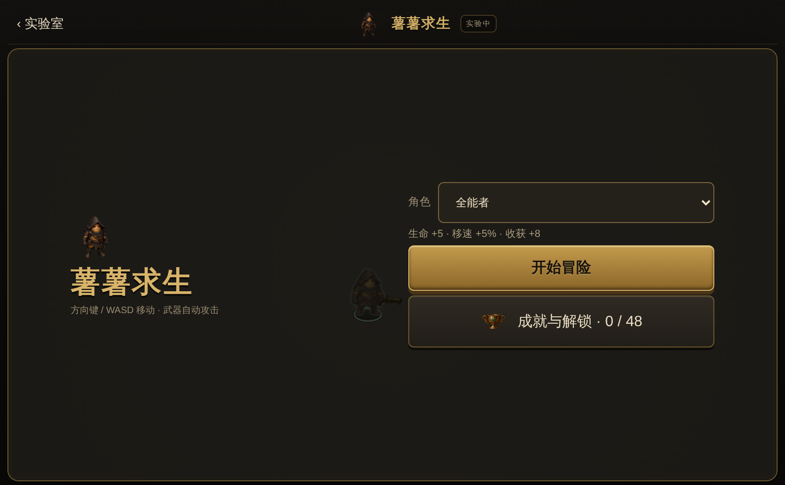

# 摄影学英语 Web

**把眼前的生活，变成英语。** 用经典电影画面练拼写、听力和口语，也能拍照制作自己的卡片。打开浏览器即可开始，无需登录。

[在线体验](https://piclex.v2fy.com/piclex-web/) · [GitHub Pages 镜像](https://zhaoolee.com/piclex-web/) · [iPhone App](https://apps.apple.com/cn/app/id6808490052)

## ARE YOU OK？


## 本项目一经推出，好评如潮！

| 图片 | 文字 |
| --- | --- |
|  | 抽象艺术家[大苦茶籽](https://www.xiaohongshu.com/user/profile/5b72c4bbd1dd410001707460) 推荐！ |
|  | 陈清泉 表示**一定要学**！ |
|  | |

## 从喜欢的电影，记住一句英语

《阿甘正传》《教父》《星球大战》……在熟悉的画面里记单词，用经典台词练听说。

<p align="center">
  <a href="https://piclex.v2fy.com/piclex-web/#/deck/b33417a7-0f7e-4081-be35-2fe44d9d30c4?module=listening&amp;mode=listening&amp;photo=1">
    
  </a>
</p>

[打开「经典电影台词」卡组](https://piclex.v2fy.com/piclex-web/#/deck/b33417a7-0f7e-4081-be35-2fe44d9d30c4) · 100 张电影卡片，100 个目标词。

电影示例为 2026-11-06 在线 Web 实际界面截图；相机截图摄于 2026-11-04～05。

## 看图拼词，听句子，开口说

<table>
  <tr><th>《阿甘正传》· 拼单词</th><th>《教父》· 练听力</th><th>《星球大战》· 练口语</th></tr>
  <tr>
    <td></td>
    <td></td>
    <td></td>
  </tr>
</table>

## 选一套喜欢的卡组

从经典电影台词开始，也有经典英语歌曲、日常生活、程序员英语、摄影等主题。支持导入自己的 `.piclexdeck`，或分享公开卡组的练习链接。

<table>
  <tr><th>电影卡组 · 浅色</th><th>电影卡组 · 深色</th></tr>
  <tr>
    <td></td>
    <td></td>
  </tr>
</table>

## 薯薯求生：拼出单词，守住花园

[立即游玩「薯薯求生」](https://piclex.v2fy.com/piclex-web/#/settings/lab)

「薯薯求生」把卡组单词带进一场横屏小冒险：移动小土豆，武器自动攻击；每波结束走进路边小店，拼对卡组单词才能把装备带走。游戏与学习共用经验。

<p align="center">
  
</p>

入口在「设置 → 我的等级」，学习页的头像等级入口也能打开同一份等级内容。

<p align="center">
  
</p>

选择角色，开始冒险。

<p align="center">
  
</p>

第 1 波战斗：移动小土豆，武器自动攻击。

<p align="center">
  
</p>

每波结束的「路边小店」：用金币从四件商品里挑一件，拼词购买；底部是随身武器栏与下一波入口。

<p align="center">
  
</p>

购买前先拼词：字母可逐个放入，拼对才能带走装备，拼错则这次购买结束。

开始页截图于 2026-11-08 重新拍摄，其余游戏与入口截图仍来自 2026-11-07 的本地 Web 实际界面；游戏横图采用约 1.618:1 的黄金比例；示例卡组为内置公开卡组「Basic English 850 场景卡片」。

## 一张照片，就是一页英语

也可以从自己的生活出发：拍摄或导入 → 双语标签与场景例句 → 开始练习。

<p align="center">
  
</p>

## 白天、夜晚，都有喜欢的样子

浅色、深色、自定义配色，搭配喜欢的键盘音。

<table>
  <tr><th>浅色相机</th><th>深色相机</th></tr>
  <tr>
    <td></td>
    <td></td>
  </tr>
</table>

进度与导入内容保存在当前浏览器；配置 WebDAV 后可跨设备自动同步等级与学习进度，照片和卡组不随轻量进度同步自动传输。AI 制卡会将照片发送给所选服务；自带 Key 保存在浏览器且未加密。相机和语音功能依赖浏览器支持与授权。

## Docker 启动与更新

**复制这一行即可：没有容器就启动，已有容器就更新。** 在运行 Docker 的电脑或服务器上执行：

```sh
docker pull zhaoolee/piclex-web:latest && (if docker container inspect piclex-web >/dev/null 2>&1; then docker stop piclex-web && docker rm piclex-web; fi) && docker run -d --name piclex-web --restart unless-stopped -p 18120:8080 zhaoolee/piclex-web:latest
```

本机打开 <http://127.0.0.1:18120>；手机或其他局域网设备打开 `http://服务器IP:18120`（换成实际 IP，并确保端口可达）。

照片和进度保存在浏览器，更新容器不会清除它们；请保持原访问地址，自定义容器名或端口映射沿用原值。[仅本机绑定、HTTPS、Compose 等详细说明](docs/docker.md)。

[使用与开发说明](docs/web-guide.md) · [发布自己的卡组](docs/publishing-decks.md) · [部署说明](deploy/README.md) · [二维码分享封面](docs/subscription-qr/README.md)

代码使用 [MIT](LICENSE)；卡组内容按原来源授权，详见[素材说明](ASSET_LICENSES.md)。

## 社区

感谢 [LINUX DO 社区](https://linux.do/) 对开源项目的支持。
